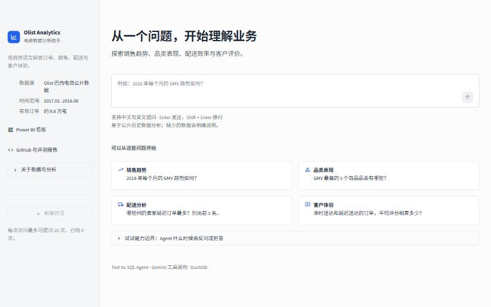
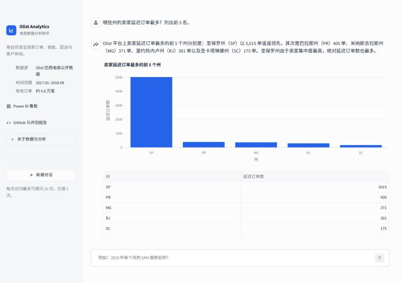
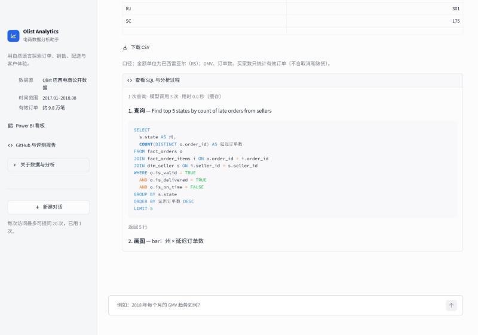

# Olist 数据分析 Agent（Text-to-SQL）

用自然语言问电商经营问题，Agent 会自己完成整个分析：
- 写 SQL，在 DuckDB 里执行；
- 读到报错后自己改写重试；
- 画图，并给出结论；
- 问题不清楚时反问，数据里没有的直接说明。

数据是巴西电商 Olist 的公开数据集，约 9.8 万笔有效订单。指标口径与我的 [Power BI 经营看板](https://github.com/Xchen-Xiaoyan/olist-bi-dashboard) 一致。





## 能做什么

| 能力 | 怎么实现 |
|---|---|
| **工具调用** | 模型通过 function calling 调用 4 个工具：`run_sql`、`make_chart`、`ask_clarification`、`decline` |
| **多步分析与自我纠错** | SQL 报错时，把数据库的错误信息回传给模型，例如"列 year_month 不存在，可能是：…"，由它改写后重试，最多 8 步 |
| **先查值再过滤** | 用户说"圣保罗市""手机"时，先查出库里实际存的值（`sao paulo`、`telephony`），再精确过滤 |
| **自检** | 还没查到数据就想作答时，会被要求先查。写最终查询前，对照清单检查是否过滤了有效订单、度量是否用对 |
| **反问与拒答** | 问题没说用哪个指标（如"哪个卖家最好"）时给出 2–4 个选项让用户选；数据里没有的（利润、年龄、2019 年）直接说明 |
| **安全** | 只允许单条只读查询，禁止访问本地文件和网络，15 秒超时，最多返回 1,000 行 |
| **可切换模型** | Gemini 免费额度用于在线 demo，Ollama 本地模型用于离线评测，全程 0 花费 |
| **过程透明** | 页面展示每一步的 SQL、报错和修正，可下载结果 CSV；支持多轮追问，例如"那 2017 年呢？" |



## 评测：Agent 什么时候值得用

我手写了 60 道题，每题都有标准 SQL。题目分 7 类：单表、多表、时间、指标口径、多步、查值、应反问/应拒答。每道题分别用"单次生成 SQL"（Baseline）和 Agent 回答，再比较结果。完整设计和逐题结果见 [eval/REPORT.md](eval/REPORT.md)。

| 模型 | 方式 | 数据题答案正确 (50) | 反问 (5) | 拒答 (5) | SQL 报错后改对 | 延迟中位数 |
|---|---|---|---|---|---|---|
| Gemini 3.5 flash-lite | 单次生成 | 96% | 100% | 100% | —（没有重试机会） | 0.7 s |
| Gemini 3.5 flash-lite | **Agent** | **98%** | 100% | 100% | **5 / 5** | 2.0 s |
| qwen2.5 7B（本地） | 单次生成 | 52% | 100% | 100% | 0 / 12 | 2.9 s |
| qwen2.5 7B（本地） | **Agent** | **66%** | 40% | 80% | 3 / 14 | 6.4 s |

"SQL 报错后改对"的 5 / 5 合计了 Agent 的两个版本：v1 报错 4 次全部改对，v2 报错 1 次也改对了。

主要结论：
- **强模型 + 好的数据字典，单次生成已经很准。** Agent 多答对的 1 题在 50 道题上不显著。它在强模型上的价值是**出错能自己改、过程可查看、能画图、能追问**，代价是延迟约增加到 3 倍。
- **弱模型受益最大**：qwen 7B 从 52% 提高到 66%，多表关联题从 50% 提高到 90%。
- **小模型在"该不该反问"上反而变差**：它会自己挑一个指标作答，或者把工具调用写成文字。所以在线 demo 用 Gemini；用小模型时应先单独做一步意图分类。
- **评分要看最终答案**：Agent 经常返回更完整的表（比如列出所有月份），再在文字里点出答案。所以我同时报告"答案正确"和"结果表精确匹配"两个指标，文本判对的回答都人工复核过。

## 项目结构

```
agent/
  schema.py    数据字典：表、字段、枚举值和指标口径（模型看到的唯一说明）
  db.py        只读执行：语句校验、禁止访问外部资源、超时、行数上限
  llm.py       可切换的工具调用后端（Gemini / Ollama），以及评测用的响应缓存
  core.py      Agent 循环与 4 个工具，加上单次生成的 Baseline
app/
  streamlit_app.py   聊天界面：答案、图表、每步 SQL、结果表、反问选项按钮
eval/
  questions.py 60 道题及标准 SQL      compare.py   结果表比对与文字答案比对
  run_eval.py  跑评测（可断点续跑）    regrade.py   修改判分规则后重判，不需要调用模型
  summarize.py 汇总成表               REPORT.md    评测报告
  results/     每题的完整步骤记录
scripts/
  build_db.py  由看板项目的清洗结果生成 data/olist.duckdb（16 MB）
  warm_demo_cache.py  预先跑好示例问题，线上点击即出结果
```

## 本地运行

```bash
python -m venv .venv && .venv\Scripts\activate
pip install -r requirements.txt
copy .env.example .env        # 填入免费的 Gemini key：https://aistudio.google.com/apikey
streamlit run app/streamlit_app.py
```

命令行提问：`python scripts/try.py "哪个品类的差评率最高？"`。也可以改用本地模型：先运行 `ollama pull qwen2.5:7b`，再在 `.env` 里设置 `LLM_PROVIDER=ollama`。

`data/olist.duckdb` 已经包含在仓库里。如果要从原始数据重建，先运行 [olist-bi-dashboard](https://github.com/Xchen-Xiaoyan/olist-bi-dashboard) 的 `scripts/build_model.py`，再运行 `python scripts/build_db.py`。

## 数据与许可

数据来自 [Brazilian E-Commerce Public Dataset by Olist](https://www.kaggle.com/datasets/olistbr/brazilian-ecommerce)，许可为 CC BY-NC-SA 4.0，仅用于非商业的学习和展示。
